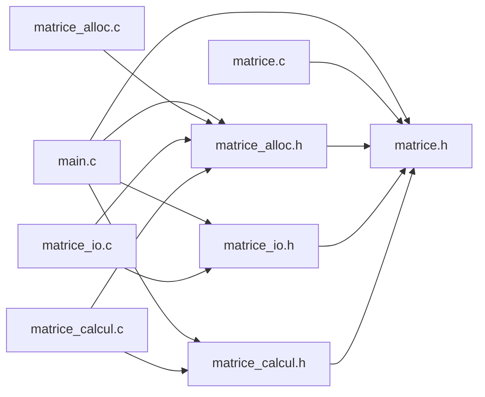
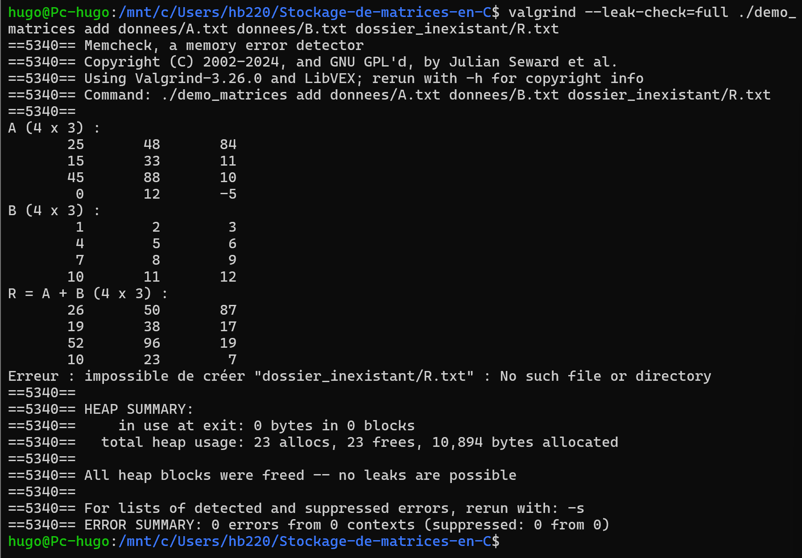
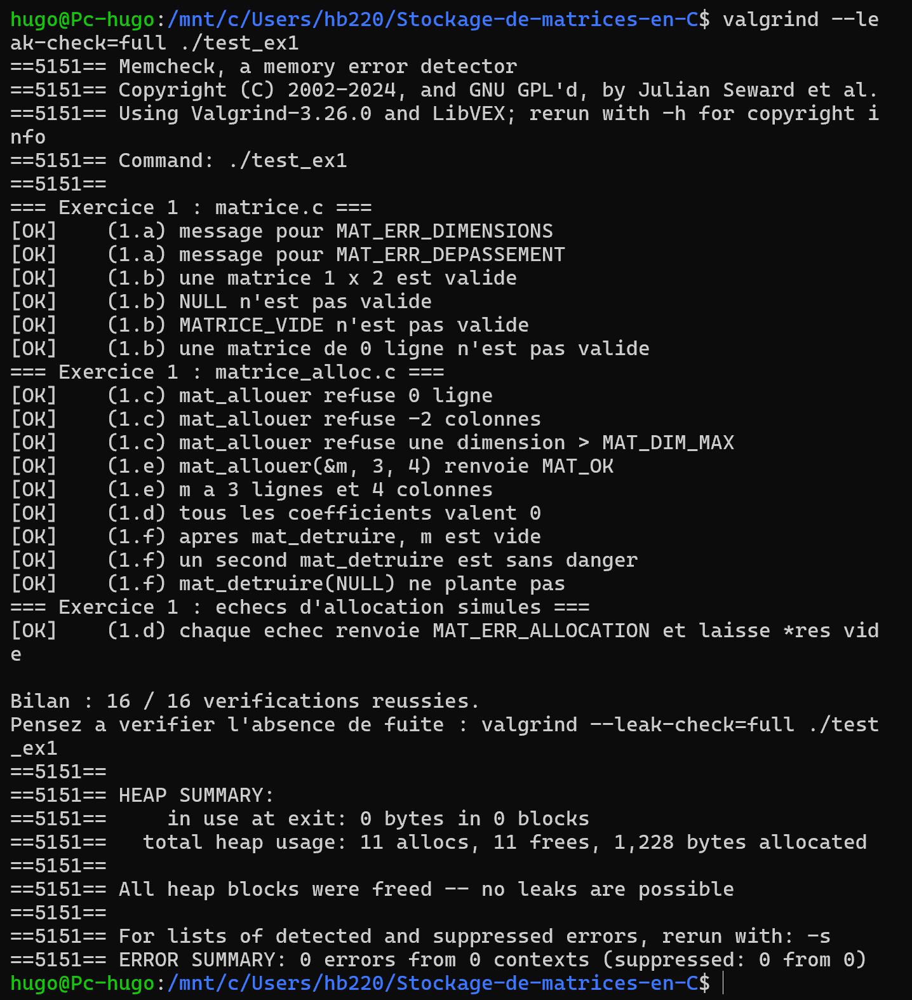
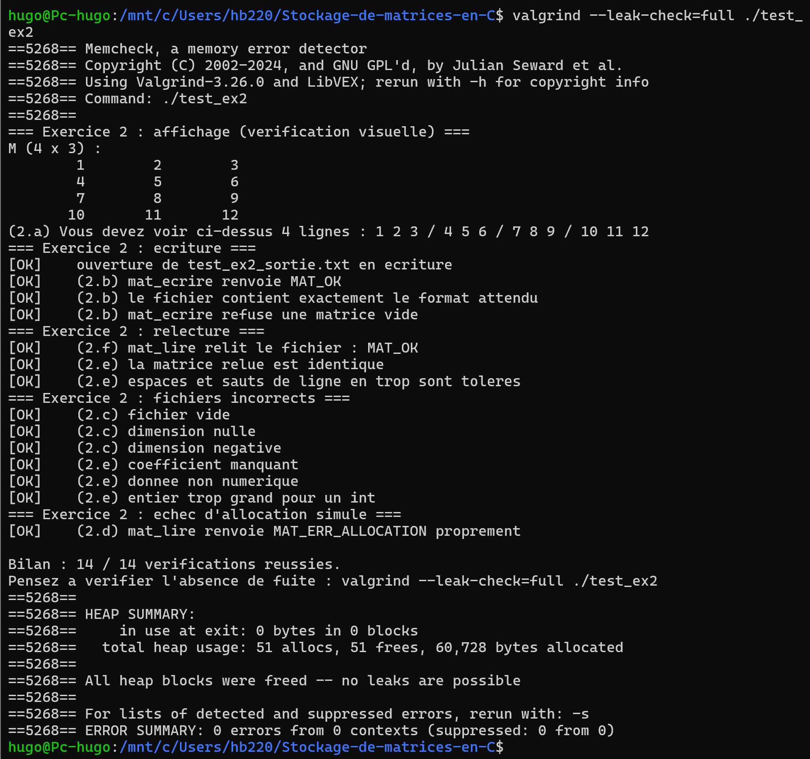
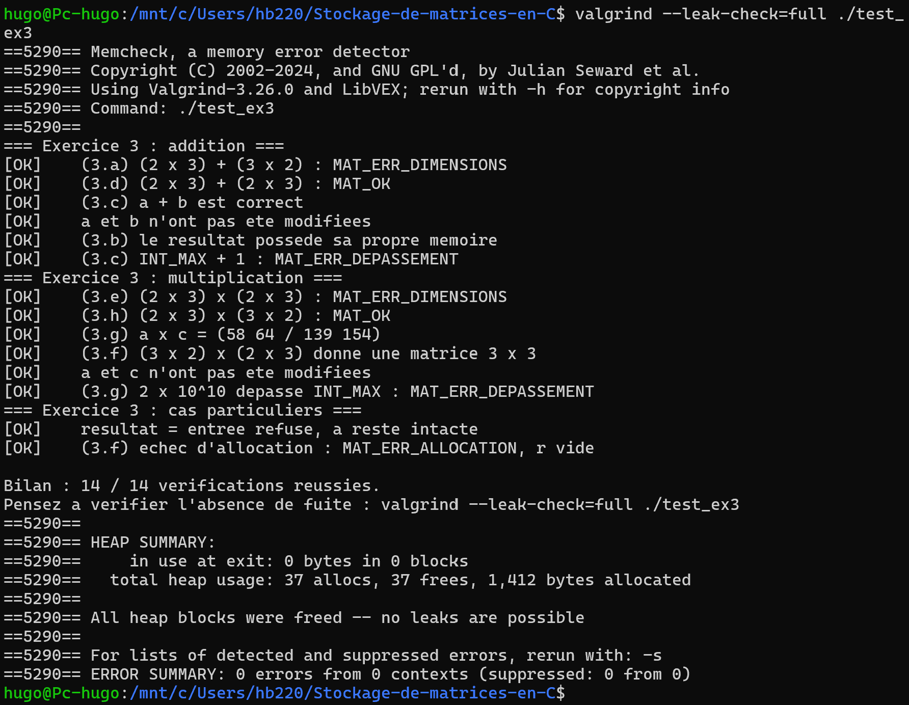
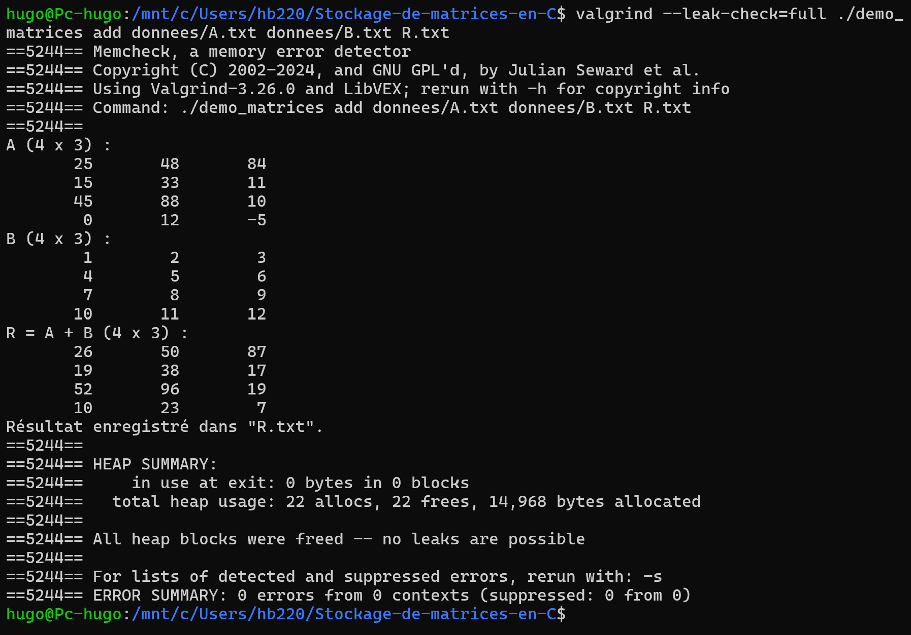
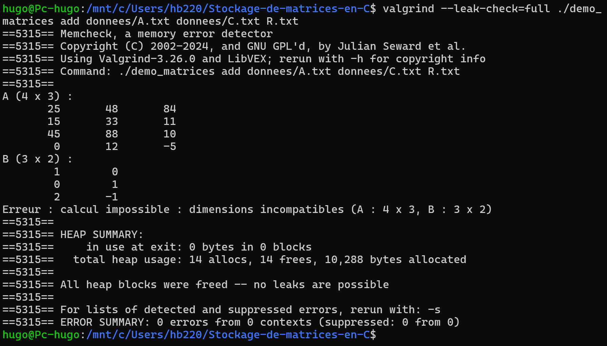

# TD Matrices : stockage de matrices en C

INSA Centre Val de Loire, 3e année STI, Programmation C (responsable : A. ADELL)

## Sommaire

1. [En-tête](#1-en-tête)
2. [Introduction](#2-introduction)
3. [Conception](#3-conception)
4. [Réalisation, exercice par exercice](#4-réalisation-exercice-par-exercice)
5. [Vérifications mémoire](#5-vérifications-mémoire)
6. [Démonstration finale](#6-démonstration-finale)
7. [Bilan et difficultés](#7-bilan-et-difficultés)

---

## 1. En-tête

| Membre | Compte GitHub | Travail réalisé |
|---|---|---|
| Hugo Boisbourdin | [IppoSeya](https://github.com/IppoSeya) | exercices 2 et 4, README |
| Yousef Ben Ammar | [yousef01010](https://github.com/yousef01010) | exercices 1 et 3, Makefile |

- **Dépôt GitHub** : https://github.com/IppoSeya/Stockage-de-matrices-en-C
- **Version rendue** : tag [`rendu`](https://github.com/IppoSeya/Stockage-de-matrices-en-C/releases/tag/rendu)
- **Groupe** : binôme

---

## 2. Introduction

Ce projet est une petite bibliothèque C qui permet de créer, enregistrer dans
un fichier texte, relire, afficher et combiner (addition, produit) des
matrices d'entiers dont la taille n'est connue qu'à l'exécution. Elle est
découpée en quatre modules (`matrice`, `matrice_alloc`, `matrice_io`,
`matrice_calcul`) et utilisée par un programme de démonstration,
`demo_matrices` ([main.c](main.c)), qui lit deux matrices, calcule leur somme
ou leur produit, affiche le résultat et l'enregistre.

Les trois objectifs du TD qui structurent le travail : séparer interface
(`.h`) et implémentation (`.c`), gérer la mémoire dynamique sans fuite y
compris lorsqu'une allocation échoue en cours de route, et signaler toute
erreur par un code de retour plutôt que par un plantage. Le code est compilé
avec `gcc -std=c11 -Wall -Wextra -Wpedantic` et ne produit aucun
avertissement.

**Compilation et lancement rapide** (sous Linux / WSL) :

```bash
make                 # compile demo_matrices et les 3 tests
make test            # lance test_ex1, test_ex2 et test_ex3
make valgrind        # les 3 tests sous valgrind
./demo_matrices add donnees/A.txt donnees/B.txt R.txt
```

---

## 3. Conception

### 3.1 Schéma des modules

```
Stockage-de-matrices-en-C/
|-- matrice.h / matrice.c                type Matrice, codes d'erreur, outils communs
|-- matrice_alloc.h / matrice_alloc.c    créer et détruire une matrice
|-- matrice_io.h / matrice_io.c          lire, écrire, afficher
|-- matrice_calcul.h / matrice_calcul.c  additionner, multiplier
|-- main.c                               programme de démonstration
|-- test_ex1.c, test_ex2.c, test_ex3.c   tests fournis
|-- donnees/                             fichiers de test
|-- Makefile
```

| Module | Rôle |
|---|---|
| `matrice` | Définit le type `Matrice`, les codes d'erreur `MatErreur` et deux outils partagés : `mat_message_erreur` (code vers message) et `mat_est_valide`. Les définitions sont dans `matrice.c` pour qu'elles n'existent qu'une fois dans le programme. |
| `matrice_alloc` | Seul module qui crée et libère la mémoire d'une matrice : `mat_allouer` et `mat_detruire`. |
| `matrice_io` | Tout ce qui touche aux flux : `mat_lire`, `mat_ecrire`, `mat_afficher`. Il n'ouvre ni ne ferme jamais de fichier. |
| `matrice_calcul` | `mat_additionner` et `mat_multiplier`, sans aucune entrée-sortie. |
| `main.c` | Programme de démonstration : ouvre et ferme les fichiers, affiche les erreurs. |

Ce découpage permet de réutiliser la bibliothèque telle quelle dans
`demo_matrices` et dans les trois programmes de test sans copier une ligne,
de ne lire que le `.h` pour utiliser un module, et de ne recompiler que les
fichiers modifiés.

### 3.2 Graphe des inclusions

Une flèche `X --> Y` signifie « X contient `#include "Y"` ». Le graphe ne
contient aucun cycle.



`matrice_calcul` n'inclut pas `matrice_io.h` parce qu'il ne lit ni n'écrit
aucun fichier : un module n'inclut que ce dont il a besoin. `matrice_io.c` et
`matrice_calcul.c` incluent en revanche `matrice_alloc.h`, car ils appellent
`mat_allouer` et `mat_detruire`.

Chaque `.h` est protégé par une garde (`#ifndef` / `#define` / `#endif`).
Sans elle, `main.c`, qui inclut `matrice.h` directement et par l'intermédiaire
des trois autres en-têtes, définirait deux fois le type `Matrice` et la
compilation échouerait. Chaque `.c` inclut son propre `.h`, ce qui fait
vérifier au compilateur que prototypes et définitions concordent.

### 3.3 Représentation d'une matrice en mémoire

Une matrice est une structure de trois champs : `int **coef`, `nb_lignes` et
`nb_colonnes`. `coef` pointe vers un tableau de `nb_lignes` pointeurs, et
chaque `coef[i]` pointe vers un tableau de `nb_colonnes` entiers alloué
séparément : une matrice n × p occupe donc **1 + n blocs** sur le tas, et on
écrit `a.coef[i][j]` comme avec un tableau à deux dimensions. Les dimensions
sont stockées dans la structure car un pointeur ne connaît pas la taille de
la zone qu'il désigne. La constante `MATRICE_VIDE` désigne une matrice qui ne
possède aucune mémoire (`coef == NULL`, dimensions à 0), et `MAT_DIM_MAX`
(10 000) protège contre les fichiers aberrants.

### 3.4 Gestion des erreurs

Toute fonction qui peut échouer renvoie un code `MatErreur` (`MAT_OK`, qui
vaut 0, en cas de succès). Le résultat passe par un paramètre de sortie
(`Matrice *res`), et les matrices d'entrée sont reçues en `const Matrice *`.
La bibliothèque n'affiche rien en cas d'erreur : c'est `main.c` qui décide
quoi afficher, grâce à `mat_message_erreur`.

Renvoyer une `Matrice` par valeur ne permettrait pas de dire pourquoi une
fonction a échoué (fichier mal formé, dimensions incompatibles, mémoire
épuisée), l'appelant pourrait utiliser une matrice invalide sans le savoir,
la copie ne dupliquerait que le pointeur `coef` (la mémoire serait partagée),
et rien n'indiquerait qui doit libérer le résultat.

### 3.5 Règles de propriété de la mémoire

Elles évitent qu'une zone soit oubliée ou libérée deux fois. Les numéros de
ligne renvoient au code actuel.

| Règle | Énoncé | Où elle est appliquée dans notre code |
|---|---|---|
| R1 | Toute `Matrice` est initialisée à `MATRICE_VIDE` | [main.c#L73](main.c#L73) : `a`, `b` et `r` démarrent vides ; [matrice_io.c#L105](matrice_io.c#L105) et [matrice_alloc.c#L38](matrice_alloc.c#L38) : `*res` est mis à vide dès l'entrée dans `mat_lire` et `mat_allouer` |
| R2 | Une fonction qui réussit transfère la propriété du résultat à l'appelant | `res->coef = coef;` dans [mat_allouer](matrice_alloc.c#L76-L79), `*res = tmp;` dans [mat_lire](matrice_io.c#L168), `*res = r;` dans [mat_additionner](matrice_calcul.c#L76) et [mat_multiplier](matrice_calcul.c#L137). `main` libère ensuite avec `mat_detruire` ([main.c#L127-L129](main.c#L127-L129)) |
| R3 | Une fonction qui échoue laisse `*res` vide et a tout libéré | [mat_allouer](matrice_alloc.c#L62-L70) libère les lignes déjà obtenues, puis le tableau `coef` ; [mat_lire](matrice_io.c#L156) détruit `tmp` avant de renvoyer l'erreur ; [mat_additionner](matrice_calcul.c#L67) et [mat_multiplier](matrice_calcul.c#L122) détruisent `r` avant `MAT_ERR_DEPASSEMENT` |
| R4 | Une matrice reçue en `const Matrice *` n'est jamais modifiée ni libérée | `a` et `b` sont `const` dans `mat_additionner` et `mat_multiplier`, `m` dans `mat_ecrire` et `mat_afficher`. Le test de `test_ex3` « a et b n'ont pas été modifiées » le vérifie |
| R5 | `*res` est un paramètre de sortie, distinct des entrées | [verifier_parametres](matrice_calcul.c#L19-L20) renvoie `MAT_ERR_ARGUMENT` si `res == a` ou `res == b`, avant toute modification |
| R6 | `mat_detruire` remet la matrice à `MATRICE_VIDE` : un second appel est sans effet | [matrice_alloc.c#L93-L99](matrice_alloc.c#L93-L99) : libération conditionnée par `m->coef != NULL`, puis `*m = MATRICE_VIDE` |
| R7 | Un fichier est fermé par le code qui l'a ouvert | `fopen` et `fclose` ne figurent que dans [charger](main.c#L24) et [sauvegarder](main.c#L45) de `main.c` ; aucune fonction de `matrice_io.c` ne ferme le flux reçu |

### 3.6 Makefile

Le [Makefile](Makefile) offre quatre cibles : `make` (ou `make all`) compile
`demo_matrices` et les trois tests, `make test` lance les trois tests,
`make valgrind` les passe sous valgrind, `make clean` supprime les `.o` et
les exécutables ainsi que les fichiers (`R.txt`, `R2.txt`,
   `resultat_add.txt`, `test_ex2_sortie.txt`).

La compilation est séparée : chaque `.c` donne un `.o` (`gcc -c`), puis
l'édition de liens assemble les `.o`. Un `.o` dépend de son `.c` et de tous
les `.h`, donc `make` ne recompile que ce qui a changé (et tout si un `.h`
change). Les tests sont compilés avec `-DMAT_TEST_ALLOC`, qui active la
simulation d'échec d'allocation dans `matrice_alloc.c`, alors que le
programme de démonstration ne doit pas l'avoir : leurs objets sont donc
compilés à part, avec le suffixe `.test.o` (par exemple `matrice.test.o`).
Les options sont celles du sujet : `-std=c11 -Wall -Wextra -Wpedantic -g`.


## 4. Réalisation, exercice par exercice

### 4.1 Exercice 1 : allocation et destruction

**Fichiers** : [matrice.c](matrice.c), [matrice_alloc.c](matrice_alloc.c)

Dans `matrice.c`, `mat_message_erreur` a reçu les deux messages manquants
(« dimensions incompatibles » et « dépassement de capacité »), et
`mat_est_valide` est un seul `return` qui enchaîne quatre conditions avec
`&&`. L'ordre compte : `m != NULL` est testé en premier, car le `&&`
s'arrête dès qu'une condition est fausse, ce qui évite de lire `m->coef`
quand `m` est `NULL`.

Dans `matrice_alloc.c`, `mat_allouer` refuse les dimensions hors de
`[1, MAT_DIM_MAX]`, réserve le tableau de pointeurs, puis chaque ligne. Le
point délicat est l'échec au milieu de la boucle : si la ligne `i` ne peut pas
être allouée, il faut rendre les lignes `i-1` à 0 puis le tableau `coef`
avant de renvoyer `MAT_ERR_ALLOCATION` ([matrice_alloc.c#L62-L70](matrice_alloc.c#L62-L70)) :

```c
for (int i = 0; i < nb_lignes; i++) {
    coef[i] = mat_calloc((size_t)nb_colonnes, sizeof **coef);
    if (coef[i] == NULL) {
        for (int k = i - 1; k >= 0; k--)   /* lignes déjà obtenues */
            free(coef[k]);
        free(coef);                        /* puis le tableau */
        return MAT_ERR_ALLOCATION;
    }
}
```

`*res` n'est rempli (trois affectations) qu'une fois tout réussi, pour ne
jamais rendre une matrice à moitié construite. `mat_detruire` libère les
lignes puis le tableau, et remet la matrice à vide.

**Résultat du test** (`make test_ex1 && ./test_ex1`) :

```text
=== Exercice 1 : matrice.c ===
[OK]    (1.a) message pour MAT_ERR_DIMENSIONS
[OK]    (1.a) message pour MAT_ERR_DEPASSEMENT
[OK]    (1.b) une matrice 1 x 2 est valide
[OK]    (1.b) NULL n'est pas valide
[OK]    (1.b) MATRICE_VIDE n'est pas valide
[OK]    (1.b) une matrice de 0 ligne n'est pas valide
=== Exercice 1 : matrice_alloc.c ===
[OK]    (1.c) mat_allouer refuse 0 ligne
[OK]    (1.c) mat_allouer refuse -2 colonnes
[OK]    (1.c) mat_allouer refuse une dimension > MAT_DIM_MAX
[OK]    (1.e) mat_allouer(&m, 3, 4) renvoie MAT_OK
[OK]    (1.e) m a 3 lignes et 4 colonnes
[OK]    (1.d) tous les coefficients valent 0
[OK]    (1.f) apres mat_detruire, m est vide
[OK]    (1.f) un second mat_detruire est sans danger
[OK]    (1.f) mat_detruire(NULL) ne plante pas
=== Exercice 1 : echecs d'allocation simules ===
[OK]    (1.d) chaque echec renvoie MAT_ERR_ALLOCATION et laisse *res vide

Bilan : 16 / 16 verifications reussies.
```

**Questions de réflexion**

**Q3.1** Pourquoi `mat_detruire` prend-elle un `Matrice *` et non un `Matrice` ?

> Elle doit modifier la matrice de l'appelant : à la fin, elle fait
> `*m = MATRICE_VIDE`. Avec un passage par valeur, elle recevrait une copie de
> la structure (les deux entiers et le pointeur `coef`) : elle libérerait bien
> les blocs, mais elle ne remettrait à vide que sa copie. La variable de
> l'appelant garderait un `coef` qui pointe vers de la mémoire déjà libérée, 
> et un second `mat_detruire` ou une utilisation ultérieure provoquerait une 
> double libération ou un accès invalide.

**Q3.2** Combien d'appels à `calloc` et à `free` pour une matrice n × p ? Si la
k-ième allocation échoue, combien de libérations ?

> Une matrice n × p demande **1 + n** appels à `calloc` (le tableau de n
> pointeurs, puis une ligne de p entiers par ligne) et donc **1 + n** appels à
> `free` à la destruction. Si la k-ième allocation échoue, `k - 1` blocs ont
> déjà été obtenus et `mat_allouer` fait exactement **k - 1** libérations. Par
> exemple, si le tout premier `calloc` (celui du tableau) échoue, il n'y a rien
> à libérer ; si c'est la ligne `i` (0 pour la première) qui échoue, c'est la
> (i + 2)-ième allocation et le code libère les `i` lignes précédentes puis
> `coef`, soit `i + 1` appels à `free`.

**Q3.3** Pourquoi appeler deux fois `mat_detruire` est-il sans danger ? Et avec
une copie `Matrice b = a;` ?

> Le premier appel remet la matrice à `MATRICE_VIDE`, donc `coef` vaut `NULL`.
> Le second appel voit `m->coef == NULL`, ne libère rien et remet de nouveau à
> vide : c'est la règle R6. Ce n'est plus vrai avec une copie : `b = a` copie le
> pointeur `coef`, `mat_detruire(&a)` libère les blocs et ne vide que `a`, mais
> `b.coef` contient toujours l'ancienne adresse. `mat_detruire(&b)` libère alors
> une deuxième fois les mêmes blocs, ce qui est un comportement indéfini
> (double libération). Il ne faut donc jamais copier une `Matrice` pour la
> posséder deux fois.

**Q3.4** Pourquoi `mat_allouer` commence-t-elle par `*res = MATRICE_VIDE`, avant
même de vérifier les dimensions ?

> Pour respecter la règle R3 sur tous les chemins : quelle que soit la façon
> dont la fonction échoue (dimensions invalides, échec d'allocation), l'appelant
> récupère une matrice vide, sur laquelle `mat_detruire` est sans danger.
> Sans cela, une erreur de dimensions laisserait `*res` avec son contenu
> d'avant (éventuellement non initialisé), et l'appelant pourrait l'utiliser
> ou le libérer à tort.

### 4.2 Exercice 2 : entrées-sorties

**Fichier** : [matrice_io.c](matrice_io.c)

`mat_afficher` affiche chaque coefficient sur 8 caractères (`" %8d"`) pour
aligner les colonnes. `mat_ecrire` écrit les dimensions (code fourni), puis
chaque ligne au format canonique : le premier coefficient avec `"%d"`, les
suivants avec `" %d"` (donc aucun espace en fin de ligne), puis un saut de
ligne. Chaque `fprintf` et le `fputc` du saut de ligne sont testés : un
retour négatif (ou `EOF`) donne `MAT_ERR_ECRITURE`.

`mat_lire` suit quatre temps ([matrice_io.c#L137-L168](matrice_io.c#L137-L168)) : les
dimensions lues doivent être dans `[1, MAT_DIM_MAX]` (sinon `MAT_ERR_FORMAT`,
puisque c'est le contenu du fichier qui est faux, pas les paramètres) ; on
alloue une matrice **locale** `tmp` ; on lit les n × p coefficients avec
`lire_entier`, en détruisant `tmp` à la première erreur ; enfin, tout ayant
réussi, `*res = tmp` transfère la propriété à l'appelant.

```c
for (int i = 0; i < nb_lignes; i++) {
    for (int j = 0; j < nb_colonnes; j++) {
        err = lire_entier(f, &tmp.coef[i][j]);
        if (err != MAT_OK) {
            mat_detruire(&tmp);   /* sinon fuite : tmp possède de la mémoire */
            return err;
        }
    }
}
```

**Résultat du test** (`make test_ex2 && ./test_ex2`, extrait) :

```text
=== Exercice 2 : fichiers incorrects ===
[OK]    (2.c) fichier vide
[OK]    (2.c) dimension nulle
[OK]    (2.c) dimension negative
[OK]    (2.e) coefficient manquant
[OK]    (2.e) donnee non numerique
[OK]    (2.e) entier trop grand pour un int
=== Exercice 2 : echec d'allocation simule ===
[OK]    (2.d) mat_lire renvoie MAT_ERR_ALLOCATION proprement

Bilan : 14 / 14 verifications reussies.
```

Le fichier `test_ex2_sortie.txt` produit par le test contient
`4 3`, `1 2 3`, `4 5 6`, `7 8 9`, `10 11 12`, soit le format canonique.

**Questions de réflexion**

**Q4.1** Pourquoi `mat_lire` remplit-elle d'abord une matrice locale avant de
l'affecter à `*res` ?

> Si une erreur survient au milieu du fichier (caractère non numérique, entier
> trop grand, fichier tronqué), la fonction a déjà alloué la matrice et rempli
> une partie des coefficients. En travaillant sur `tmp`, elle peut simplement la
> détruire et renvoyer l'erreur, et `*res` reste `MATRICE_VIDE` (règle R3) :
> l'appelant ne reçoit jamais de matrice à moitié remplie, dont une partie
> serait fausse sans qu'il le sache. Le transfert `*res = tmp` n'a lieu qu'à la
> toute fin, quand tout est lu.

**Q4.2** La lecture vérifie-t-elle que chaque ligne de la matrice est sur sa propre ligne de
texte ? Est-ce gênant ? Justifiez « tolérant en lecture, strict en écriture ».

> Non. `lire_entier` utilise `fscanf("%31s")`, qui saute tous les blancs
> (espaces, tabulations, sauts de ligne) : `mat_lire` lit exactement n × p
> entiers, qu'ils soient sur une seule ligne ou répartis différemment. Ce n'est
> pas gênant, c'est même voulu : un fichier modifié à la main ou produit par un
> autre outil reste lisible, et ce que l'on contrôle strictement est le
> contenu (dimensions valides, bon nombre d'entiers, chacun représentable par
> un `int`). En écriture, au contraire, on impose un format canonique unique
> (un espace, pas d'espace en fin de ligne, saut de ligne après chaque ligne) :
> la sortie est prévisible, comparable octet par octet dans les tests et lisible
> par n'importe quel lecteur, même un lecteur strict.

**Q4.3** Après l'appel `mat_lire(f, &m)`, le flux `f` est positionné après le dernier
coefficient. Comment exploiter cette propriété pour stocker deux matrices dans
un même fichier ?

> On ouvre le fichier une seule fois, puis on appelle `mat_lire` deux fois de
> suite sur le même `FILE *` : le premier appel lit la première matrice et
> laisse le flux juste après son dernier coefficient, le second appel lit donc
> la matrice suivante (sa ligne de dimensions, puis ses coefficients). De même
> en écriture : deux appels consécutifs à `mat_ecrire` sur le même flux
> écrivent les deux matrices l'une après l'autre. Cela marche parce que
> `mat_lire` et `mat_ecrire` ne ferment jamais le flux (règle R7). Le
> fichier a alors la forme : dimensions de A, coefficients de A, dimensions de
> B, coefficients de B.

**Q4.4** Pourquoi `mat_ecrire` appelle-t-elle `fflush` avant de renvoyer
`MAT_OK` ? Cela dispense-t-il l'appelant de tester `fclose` ?

> `fprintf` écrit d'abord dans un tampon en mémoire : une erreur d'écriture
> réelle (disque plein, par exemple) peut n'apparaître que lorsque le tampon
> est vidé vers le fichier. `fflush` force cet envoi tout de suite et renvoie
> `EOF` en cas de problème, ce qui permet à `mat_ecrire` de signaler
> `MAT_ERR_ECRITURE` au lieu de dire `MAT_OK` à tort. Cela ne dispense pas de
> tester `fclose` : `fclose` peut lui-même échouer (il vide aussi le tampon et
> libère le flux), et c'est souvent là qu'une erreur différée apparaît. C'est
> pourquoi `sauvegarder` dans `main.c` teste `fclose(f) == EOF`.

### 4.3 Exercice 3 : calcul matriciel

**Fichier** : [matrice_calcul.c](matrice_calcul.c)

`mat_additionner` vérifie que `a` et `b` ont les mêmes dimensions (lignes **et**
colonnes, pas seulement le nombre de coefficients), alloue `r` à la taille de
`a`, puis calcule chaque somme dans un `long long`
([matrice_calcul.c#L64](matrice_calcul.c#L64)) :

```c
long long s = (long long)a->coef[i][j] + b->coef[i][j];
```

La conversion est indispensable : sans elle, la somme serait calculée en
`int` et pourrait déborder (comportement indéfini) avant le test
`tient_dans_int`. En cas de dépassement, `r` est détruite avant de renvoyer
`MAT_ERR_DEPASSEMENT`.

`mat_multiplier` exige `a->nb_colonnes == b->nb_lignes`, alloue `r` de taille
(lignes de `a`) × (colonnes de `b`), puis accumule les produits dans un
`long long`. La somme de plusieurs produits peut elle-même dépasser un
`long long` : chaque addition est donc contrôlée avant d'être faite
([matrice_calcul.c#L119-L126](matrice_calcul.c#L119-L126)). Dans les deux
fonctions, `r` est un résultat local transféré à `*res` seulement à la fin.

**Résultat du test** (`make test_ex3 && ./test_ex3`) :

```text
=== Exercice 3 : addition ===
[OK]    (3.a) (2 x 3) + (3 x 2) : MAT_ERR_DIMENSIONS
[OK]    (3.d) (2 x 3) + (2 x 3) : MAT_OK
[OK]    (3.c) a + b est correct
[OK]    a et b n'ont pas ete modifiees
[OK]    (3.b) le resultat possede sa propre memoire
[OK]    (3.c) INT_MAX + 1 : MAT_ERR_DEPASSEMENT
=== Exercice 3 : multiplication ===
[OK]    (3.e) (2 x 3) x (2 x 3) : MAT_ERR_DIMENSIONS
[OK]    (3.h) (2 x 3) x (3 x 2) : MAT_OK
[OK]    (3.g) a x c = (58 64 / 139 154)
[OK]    (3.f) (3 x 2) x (2 x 3) donne une matrice 3 x 3
[OK]    a et c n'ont pas ete modifiees
[OK]    (3.g) 2 x 10^10 depasse INT_MAX : MAT_ERR_DEPASSEMENT
=== Exercice 3 : cas particuliers ===
[OK]    resultat = entree refuse, a reste intacte
[OK]    (3.f) echec d'allocation : MAT_ERR_ALLOCATION, r vide

Bilan : 14 / 14 verifications reussies.
```

**Questions de réflexion**

**Q5.1** Le paramètre `const Matrice *a` empêche-t-il d'écrire `a->coef[0][0] = 7;` ?
Que protège exactement ce `const` ? Que faudrait-il changer pour que le
compilateur refuse cette affectation ?

> Non. `const Matrice *a` interdit de modifier les champs de la structure
> (`a->nb_lignes = 7;` et `a->coef = NULL;` sont refusés), mais pas les
> coefficients : `a->coef[0][0] = 7;` compile sans erreur, car `coef` est un
> `int **` et le `const` ne protège que ce pointeur, pas les entiers vers lesquels
> il mène. Pour que le compilateur refuse cette affectation, il faudrait déclarer
> `const int *const *coef;` dans `matrice.h`, mais les en-têtes sont imposés et ne
> peuvent pas être modifiés. Dans notre projet, ne pas modifier les matrices
> d'entrée reste donc une règle que le code respecte (R4), vérifiée par le test
> « a et b n'ont pas été modifiées ».

**Q5.2** Pourquoi refuse-t-on l'appel `mat_additionner(&a, &b, &a)` alors que,
mathématiquement, `a ← a + b` a un sens ? Que se passerait-il avec notre
implémentation si on l'acceptait ?

> `res` est un paramètre de sortie dont l'ancien contenu est écrasé (R5). Notre
> implémentation commence par `*res = MATRICE_VIDE` dans `verifier_parametres` :
> si `res == a`, cette ligne efface `a` avant même qu'on ait lu ses
> coefficients (`a.coef` vaut `NULL`, les dimensions 0), et la mémoire de `a`
> est perdue sans avoir été libérée (fuite). Même sans cela, la fin de la
> fonction fait `*res = r`, qui écraserait le `coef` de `a` sans libérer ses
> anciennes lignes. D'où le refus (`MAT_ERR_ARGUMENT`) tant que `res` est
> `a` ou `b`. Pour obtenir `a ← a + b`, on calcule dans une troisième matrice,
> puis on détruit `a` et on lui affecte le résultat.

**Q5.3** Combien de multiplications d'entiers effectue `mat_multiplier` pour des
matrices n × p et p × q ? Combien pour deux matrices 1000 × 1000 ?

> Le résultat a n × q coefficients, et chacun est une somme de p produits :
> **n × p × q** multiplications. Pour deux matrices 1000 × 1000, on a
> n = p = q = 1000, soit 1000³ = **10⁹ multiplications** (un milliard), plus
> autant d'additions. La complexité est cubique, d'où un temps de calcul qui
> croît très vite avec la taille.

**Q5.4** Pourquoi ne suffit-il pas de calculer `int s = a + b;` puis de tester
`s < a` pour détecter un dépassement ?

> Parce que le dépassement d'un calcul sur des `int` signés est un comportement
> indéfini en C : le calcul `a + b` peut déjà être invalide avant que l'on
> teste le résultat, et le compilateur est autorisé à supposer que cela n'arrive
> jamais, donc à supprimer le test lors de l'optimisation. De plus, le test
> `s < a` ne dit la vérité que si `b` est positif : avec `b` négatif, `s < a` est
> normal et n'indique aucun dépassement. Il faut donc détecter le dépassement
> **avant** qu'il ne se produise, ce que fait notre code en calculant dans un
> type plus large (`long long`), puis en vérifiant que le résultat tient entre
> `INT_MIN` et `INT_MAX`.

### 4.4 Exercice 4 : programme de démonstration

**Fichier** : [main.c](main.c)

`main` vérifie les arguments (opération `add` ou `mul`, 4 paramètres), déclare
`a`, `b`, `r` à `MATRICE_VIDE` (R1) et un `statut` initialisé à
`EXIT_FAILURE`. Les fonctions `charger` et `sauvegarder` ouvrent, utilisent
la bibliothèque, puis ferment le fichier (R7), `sauvegarder` testant aussi
`fclose`. Ensuite, le programme affiche A et B, calcule R avec
`addition ? mat_additionner(...) : mat_multiplier(...)`, l'affiche, l'enregistre
puis passe `statut` à `EXIT_SUCCESS`.

Toutes les erreurs convergent par un `goto nettoyage` vers un **point de sortie
unique** ([main.c#L124-L130](main.c#L124-L130)), où `mat_detruire` est appelée
sur `r`, `b` et `a`. Comme `mat_detruire` est sans effet sur une matrice
vide (R6), le nettoyage n'a pas besoin de savoir lesquelles ont été
créées : chaque matrice est détruite exactement une fois, quel que soit le
chemin suivi. En cas d'erreur, un message précis est écrit sur `stderr` (quel
fichier, quelle opération, quelle cause) et le code de sortie est
`EXIT_FAILURE`.

**Q6.1** Pourquoi le message d'erreur est-il affiché par `main.c` (ou ses
fonctions `static`) et non par `mat_lire` ?

> Parce que la bibliothèque ne doit pas décider de la façon de signaler une
> erreur : cela dépend du programme qui l'utilise. Un programme en console
> écrit sur `stderr`, un programme graphique ouvrirait une boîte de dialogue,
> un service écrirait dans un journal, et un test automatique ne veut aucun
> affichage. En renvoyant seulement un code (`MatErreur`), `mat_lire` reste
> réutilisable partout, et `main.c`, qui connaît le contexte (nom du fichier,
> opération en cours), peut produire un message précis grâce à
> `mat_message_erreur`. `mat_lire` ne connaît même pas le nom du fichier : elle
> reçoit un `FILE *`.

**Q6.2** Pourquoi le résultat de `fclose` est-il testé dans `sauvegarder` mais pas
dans `charger` ?

> En écriture, des données peuvent encore se trouver dans le tampon : `fclose`
> les envoie vers le disque, et c'est souvent à ce moment que se révèle une
> erreur (disque plein, quota dépassé). Ignorer son résultat reviendrait à
> annoncer « résultat enregistré » alors que le fichier est incomplet. En
> lecture, il n'y a rien à écrire : toutes les données utiles ont déjà été
> lues et vérifiées par `mat_lire` (erreurs de format ou de flux), donc un échec
> de `fclose` ne changerait rien au résultat.

**Q6.3** Dans le scénario 8, le calcul a réussi mais l'enregistrement a échoué.
Combien de matrices faut-il libérer ? Vérifiez que votre programme le fait.

> Trois : `a` et `b` (lues depuis les fichiers) et `r` (le résultat du calcul)
> sont toutes allouées au moment où `fopen` échoue dans `sauvegarder`. Le
> programme fait `goto nettoyage`, où `mat_detruire(&r)`, `mat_detruire(&b)` et
> `mat_detruire(&a)` sont exécutées (voir [main.c#L127-L129](main.c#L127-L129)),
> donc les trois sont libérées. Vérification avec valgrind sur ce scénario :
>
> 

---

## 5. Vérifications mémoire

Commande utilisée : `valgrind --leak-check=full ./<programme>`. Ce qu'on
cherche à la fin du rapport est la ligne
`All heap blocks were freed -- no leaks are possible`.

| Programme | Cas | Résultat attendu | Observé |
|---|---|---|---|
| `test_ex1` | tests complets (dont échecs d'allocation simulés) | `All heap blocks were freed` | voir capture n° 1 |
| `test_ex2` | tests complets (dont 6 fichiers incorrects) | idem | voir capture n° 2 |
| `test_ex3` | tests complets (dont dépassement) | idem | voir capture n° 3 |
| `demo_matrices` | `add A.txt B.txt R.txt` (succès) | idem | voir capture n° 4 |
| `demo_matrices` | `add A.txt C.txt R.txt` (dimensions incompatibles) | idem | voir capture n° 5 |
| `demo_matrices` | `add A.txt B.txt dossier_inexistant/R.txt` (échec d'enregistrement) | idem | voir capture n° 6 |

**Captures valgrind** (la commande tapée et la fin du rapport sont visibles
sur chaque image) :

**Capture n° 1 : `test_ex1`**



**Capture n° 2 : `test_ex2`**



**Capture n° 3 : `test_ex3`**



**Capture n° 4 : `demo_matrices`, cas réussi** (`add A.txt B.txt R.txt`)



**Capture n° 5 : `demo_matrices`, dimensions incompatibles** (`add A.txt C.txt R.txt`)



**Capture n° 6 : `demo_matrices`, échec d'enregistrement** (dossier inexistant)


**Chemins d'erreur couverts.** Les fuites se cachent souvent dans les chemins
d'erreur plutôt que dans le cas normal, c'est pourquoi les tests fournis
les provoquent volontairement :

- *échec d'allocation au milieu de la création* : `test_ex1` et `test_ex2`
  simulent un `calloc` qui échoue à chaque position grâce à
  `-DMAT_TEST_ALLOC` ; `mat_allouer` libère alors les lignes déjà obtenues et
  le tableau `coef` ;
- *fichier mal formé* : `test_ex2` lit six fichiers invalides (vide,
  dimension nulle ou négative, coefficient manquant, donnée non numérique,
  entier trop grand) ; `mat_lire` détruit `tmp` avant de renvoyer l'erreur ;
- *dimensions incompatibles et dépassement* : `test_ex3` ; `r` est détruite
  avant chaque retour d'erreur après son allocation ;
- *échec dans le programme complet* : `demo_matrices` passe par `goto
  nettoyage`, qui détruit les trois matrices quel que soit le point d'échec.

---

## 6. Démonstration finale

### Scénario 1 : addition réussie

```console
$ ./demo_matrices add donnees/A.txt donnees/B.txt R.txt
A (4 x 3) :
       25       48       84
       15       33       11
       45       88       10
        0       12       -5
B (4 x 3) :
        1        2        3
        4        5        6
        7        8        9
       10       11       12
R = A + B (4 x 3) :
       26       50       87
       19       38       17
       52       96       19
       10       23        7
Résultat enregistré dans "R.txt".
$ echo $?
0
```

Contenu du fichier `R.txt` produit (format canonique) :

```text
4 3
26 50 87
19 38 17
52 96 19
10 23 7
```

### Scénario 2 : produit réussi

```console
$ ./demo_matrices mul donnees/A.txt donnees/C.txt R.txt
A (4 x 3) :
       25       48       84
       15       33       11
       45       88       10
        0       12       -5
B (3 x 2) :
        1        0
        0        1
        2       -1
R = A x B (4 x 2) :
      193      -36
       37       22
       65       78
      -10       17
Résultat enregistré dans "R.txt".
$ echo $?
0
```

Le résultat est bien de dimensions 4 × 2 (par exemple 25·1 + 48·0 + 84·2 = 193).

### Scénario 3 : dimensions incompatibles (erreur)

```console
$ ./demo_matrices add donnees/A.txt donnees/C.txt R.txt
A (4 x 3) :
       25       48       84
       15       33       11
       45       88       10
        0       12       -5
B (3 x 2) :
        1        0
        0        1
        2       -1
Erreur : calcul impossible : dimensions incompatibles (A : 4 x 3, B : 3 x 2)
$ echo $?
1
```

Aucun fichier de résultat n'est créé, et les trois matrices sont libérées par
le nettoyage final.

### Scénario 6 : fichier mal formé (erreur)

```console
$ ./demo_matrices add donnees/invalide.txt donnees/B.txt R.txt
Erreur : lecture de "donnees/invalide.txt" : fichier mal formé
$ echo $?
1
```

### Autres scénarios

| N° | Commande | Message sur stderr | Code |
|---|---|---|---|
| 4 | `./demo_matrices mul donnees/A.txt donnees/B.txt R.txt` | `Erreur : calcul impossible : dimensions incompatibles (A : 4 x 3, B : 4 x 3)` | 1 |
| 5 | `./demo_matrices add absent.txt donnees/B.txt R.txt` | `Erreur : impossible d'ouvrir "absent.txt" : No such file or directory` | 1 |
| 7 | `./demo_matrices add donnees/tronque.txt donnees/B.txt R.txt` | `Erreur : lecture de "donnees/tronque.txt" : fichier mal formé` | 1 |
| 8 | `./demo_matrices add donnees/A.txt donnees/B.txt dossier_inexistant/R.txt` | `Erreur : impossible de créer "dossier_inexistant/R.txt" : No such file or directory` | 1 |
| 10 | `./demo_matrices div donnees/A.txt donnees/B.txt R.txt` | `Usage : ./demo_matrices <add\|mul> <fichier_A> <fichier_B> <fichier_R>` | 1 |

Le fichier produit par le scénario 1 peut être relu par le programme lui-même
(`./demo_matrices add R.txt R.txt R2.txt`), ce qui valide la cohérence entre
`mat_ecrire` et `mat_lire`.

---

## 7. Bilan et difficultés

**Ce qui fonctionne.** Les trois programmes de test affichent un bilan complet
(16/16, 14/14 et 14/14), le code compile sans aucun avertissement avec
`-std=c11 -Wall -Wextra -Wpedantic`, les fichiers `.h` fournis n'ont pas été
modifiés, et les scénarios de démonstration donnent les résultats et les codes
de retour attendus. Le Makefile compile par modules et lance les tests.
Vérification valgrind : voir les captures de la [partie 5](#5-vérifications-mémoire)

Valgrind ne signale ni fuite ni erreur sur les trois programmes de test ni sur
`demo_matrices` (cas réussi, dimensions incompatibles, échec d'enregistrement) :
dans les six cas, `in use at exit: 0 bytes in 0 blocks`, la ligne
`All heap blocks were freed -- no leaks are possible` s'affiche et
`ERROR SUMMARY` indique 0 erreur. Le nombre d'allocations est toujours égal au
nombre de libérations (11/11 pour `test_ex1`, 51/51 pour `test_ex2`, 37/37 pour
`test_ex3`, 22/22, 14/14 et 23/23 pour les trois cas de `demo_matrices`), y
compris sur les chemins d'erreur.

**Aides extérieures.**

- *Utilisation d'IA* : L'ia a été utilisé pour la mise en forme du fichier readme notemment
  afin de mettre les mots clé du code dans des `zone` comme celle-ci et afin de trouver comment
  afficher : shéma, lien au code et capture d'écran directement dans le readme.
  L'ia a aussi été utilisé afin d'avoir certaine explication sur Github ainsi que pour trouver
  la solution qu'a été WSL.


**Difficultés rencontrées.**

- *Technique, mémoire* : l'échec partiel d'une allocation à deux niveaux. Il
  faut rendre exactement les lignes déjà obtenues puis le tableau, dans le bon
  ordre, sans jamais laisser l'appelant avec une matrice à moitié construite.
  Passer par une matrice locale (`tmp`, `r`) transférée à `*res` à la fin
  simplifie tous les chemins d'erreur.
- *Environnement* : valgrind n'existe pas sous Windows. Nous avons installé
  WSL (Ubuntu), ce qui a demandé d'activer à la main la fonctionnalité
  « Sous-système Windows pour Linux », qui était restée désactivée, puis de
  redémarrer. Il faut ensuite distinguer deux Git (celui de Windows et celui
  d'Ubuntu) : l'authentification GitHub avec mot de passe ne marchait que dans le premier.
- *Git* : une ligne du `.gitignore` commençait par des espaces et ne
  correspondait donc à aucun fichier, ce qui a fait partir des fichiers `.o`
  dans le dépôt ; ils ont été retirés avec `git rm`. Nous avons aussi appris à
  régler un `push` refusé (`non-fast-forward`) et à annuler un commit local
  avec `git reset --soft`.

**Ce que nous avons appris.** Séparer interface et implémentation, compiler
en modules, poser des règles de propriété de la mémoire (qui alloue, qui
libère) et s'y tenir, tester chaque appel système (`fopen`, `fscanf`,
`fprintf`, `fclose`), détecter un dépassement d'entier avant qu'il ne se
produise, et travailler à deux avec Git (commits réguliers, `pull` avant
`push`).

**Répartition du travail.** Hugo Boisbourdin : exercices 2 et 4, rédaction du
compte rendu. Yousef Ben Ammar : exercices 1 et 3, Makefile. Temps passé : 3 demi-journée chacun.


